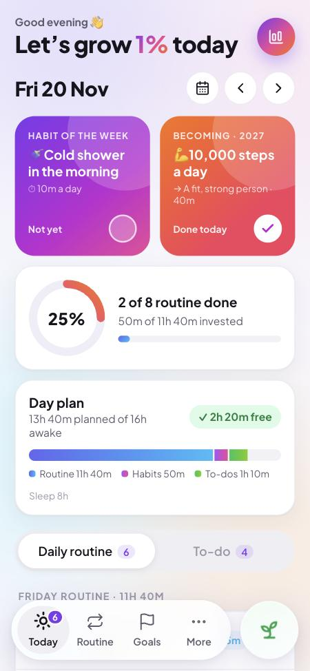
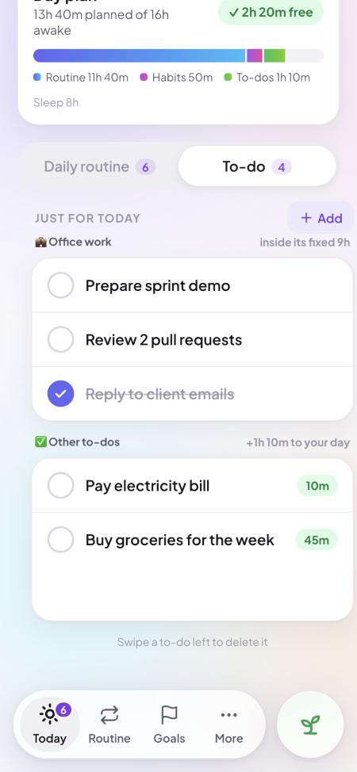
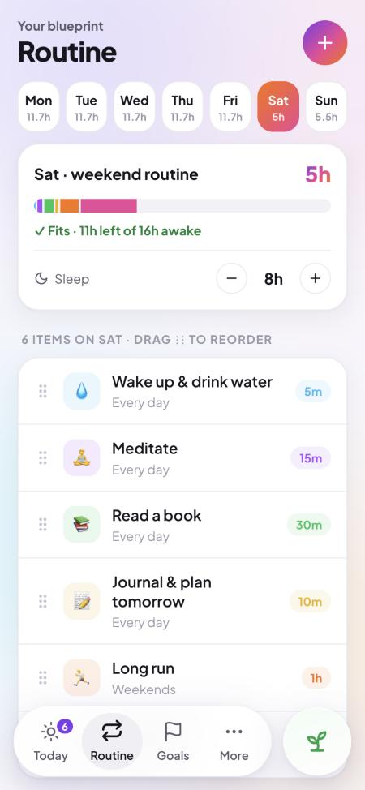
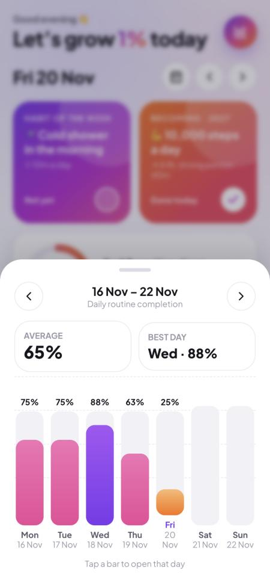
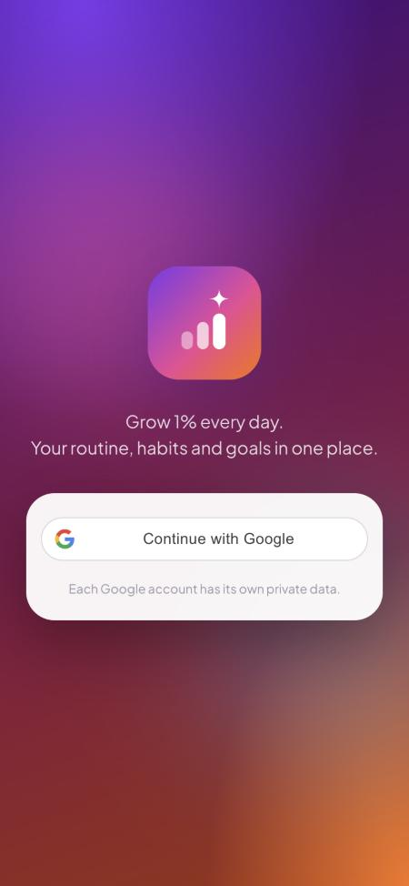
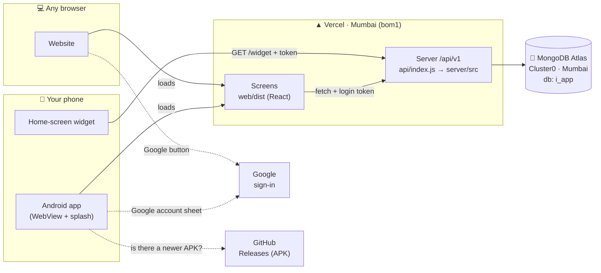
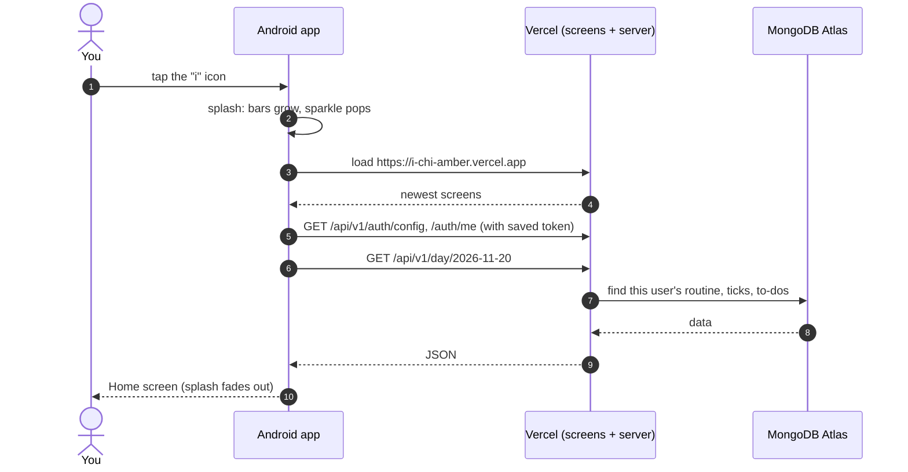
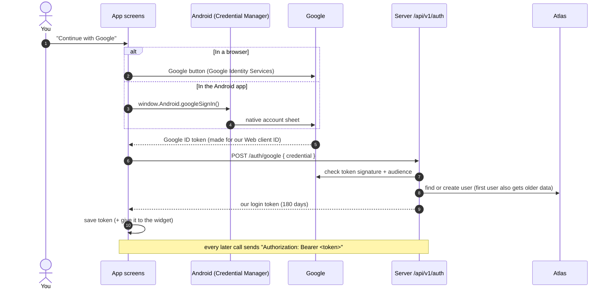

<div align="center">


# i

**Grow 1% every day.** Your daily routine, to-dos, habits and goals in one colourful app, with a home-screen widget.

[**Open the live app →**](https://i-chi-amber.vercel.app) &nbsp;·&nbsp; Android: see [Releases](https://github.com/itssinghankit/i/releases) &nbsp;·&nbsp; by **itssinghankit**


</div>

---

## Screens

| Home | To-do | Routine (per weekday) | Week chart | Sign in |
|:---:|:---:|:---:|:---:|:---:|
|  |  |  |  |  |
| Date bar, 2 habit cards, progress ring, **Day plan** (does it all fit in a day?) | Office tasks sit **inside** Office work (no extra time); others add their own time | Each weekday has its own routine, total hours per day, sleep setting | % of routine done per day, ‹ › to change week | Sign in with Google; each account has its own data |

## What it does

| Feature | Where |
|---|---|
| Daily routine with time per item, tick to mark done | Today → Daily routine |
| Different routine per weekday (e.g. weekends) | Routine tab → Mon…Sun |
| **Day plan**: routine + habits + to-dos vs. waking hours | Today |
| To-dos, optionally **inside** a fixed-time item like Office work | Today → To-do → + |
| Habit of the week, "graduates" into the routine after 5/7 days | 🌱 button |
| Who I want to be + its daily habit (shown on Home) | More → Who I want to be |
| Resolutions per year, Needs vs Wants (with ₹ totals) | Goals tab, More |
| Week chart and colour-coded calendar | 📊 button, 📅 button |
| **Insights**: the app reads your last 14 days and suggests changes | More → Insights |
| Resizable home-screen widget (tick items, + to add a to-do) | Android home screen |
| Google sign-in, private data per account | First screen |

---

## How it fits together



- **The phone app is a thin shell:** it shows the website inside the app (a WebView), plus native parts: splash screen, widget, Google account sheet and update check.
- **Most changes need no new APK:** push to GitHub, Vercel redeploys, and the phone shows the new screens on its next open.

### What happens when you open the app



### How Google sign-in works

Google doesn't allow its sign-in page inside an app's WebView. So the **website** uses Google's button, and the **Android app** uses the phone's own Google account sheet. Both end the same way.



**Each person's data is kept apart automatically.** `server/src/db/scoped.js` adds the signed-in `userId` to every read and write, so feature code can't see another user's data by mistake. The tests check this.

---

## Folder map

```
i/
├── web/                  React screens (Vite)
│   ├── src/screens/      Home, Routine, Goals, Login
│   ├── src/api.js        talks to /api/v1, keeps the login token
│   └── public/icon.svg   app icon (also the browser-tab icon)
├── server/               Node + Express
│   ├── src/app.js        list of features → add one line per new feature
│   ├── src/modules/      one file per feature (days, lists, insights, auth, widget…)
│   ├── src/db/           storage (MongoDB or local file) + per-user scoping
│   ├── src/auth/         Google token check, our login token
│   └── test/             16 API tests (incl. two users kept apart)
├── api/index.js          Vercel entry: runs the same Express app
├── vercel.json           Vercel build + routing
├── android/              WebView app, widget, splash, Google sign-in
└── .github/workflows/    ci.yml (tests on every push), release.yml (APK on tags)
```

---

## Run it on your Mac

No database or Google setup needed: it runs on a local file with dummy data, and sign-in is off.

```bash
cd /Users/mili/Data/MiliApps/i/web && npm install && npm run build
```

```bash
cd /Users/mili/Data/MiliApps/i/server && npm install && npm start
```

Open http://localhost:4600. For live-reload while editing screens, run `npm run dev` in `web/` (http://localhost:5180).

```bash
cd /Users/mili/Data/MiliApps/i && npm test
```

### Dev vs. prod: where each build gets its data

| What | Dev | Prod |
|---|---|---|
| Website | `npm start` → http://localhost:4600 | https://i-chi-amber.vercel.app |
| Android app + widget | **debug** build → `I_DEV_URL` = `http://10.0.2.2:4600` (your Mac, seen from the emulator) | **release** build → `I_APP_URL` = `https://i-chi-amber.vercel.app` |
| Set in | `android/gradle.properties` | `android/gradle.properties` |
| Database | local file `server/data/db.json` | MongoDB Atlas (`MONGODB_URI` on Vercel) |

The Android code reads one value, `BuildConfig.APP_URL`. `android/app/build.gradle.kts` fills it per build type:

```kotlin
buildTypes {
    debug   { buildConfigField("String", "APP_URL", "\"${prop("I_DEV_URL")}\"") }   // your Mac
    release { buildConfigField("String", "APP_URL", "\"${prop("I_APP_URL")}\"") }   // Vercel
}
```

`MainActivity` (the WebView) and `WidgetApi` (the widget) both use `BuildConfig.APP_URL`. For a real phone on your Wi-Fi, set `I_DEV_URL` to your Mac's Wi-Fi address, e.g. `http://192.168.1.20:4600`.

---

## Releasing


### Web + server (most changes)

```bash
cd /Users/mili/Data/MiliApps/i && git add -A && git commit -m "What changed" && git push
```

### Android (widget, splash, icon, permissions, server address)

```bash
cd /Users/mili/Data/MiliApps/i && git push && git tag v1.0.1 && git push origin v1.0.1
```

| Part | What it does |
|---|---|
| `cd /Users/mili/Data/MiliApps/i` | go to the project folder |
| `&&` | run the next part only if this one worked |
| `git push` | send your latest commits to GitHub (Vercel deploys them) |
| `git tag v1.0.1` | put a version label on your latest commit |
| `git push origin v1.0.1` | send the label to GitHub; this starts `release.yml` |

**No manual version editing.** Unlike a typical Play Store setup, you don't edit `versionCode`/`versionName` by hand. `android/app/build.gradle.kts` reads them from the tag:

| Tag | `versionName` | `versionCode` |
|---|---|---|
| `v1.0.0` | 1.0.0 | 10000 |
| `v1.0.1` | 1.0.1 | 10001 |
| `v1.2.0` | 1.2.0 | 10200 |
| `v2.0.0` | 2.0.0 | 20000 |

Rules: always go **up**, and use `vMAJOR.MINOR.PATCH` with each part below 100. Every APK is signed with the same key (`~/i-release.jks`, in GitHub secrets), so it installs over the old one. **Back up that key file and its password; without them the app can never be updated again.**

---

## Settings

### Vercel → Settings → Environment Variables

| Name | Needed | What |
|---|---|---|
| `MONGODB_URI` | ✅ | Atlas connection link (with password; `@` in the password written as `%40`) |
| `GOOGLE_CLIENT_ID` | for sign-in | Google "Web application" client ID. Setting it turns sign-in on. |
| `SESSION_SECRET` | with sign-in | Long random text that signs login tokens (32+ characters) |
| `APP_TZ` | no | Time zone for "today" (default `Asia/Kolkata`) |
| `SEED_DEMO` / `ALLOW_RESET` | no | Dummy data / reset button (off on real databases) |

### `android/gradle.properties`

| Name | What |
|---|---|
| `I_APP_URL` | Release builds load this (Vercel) |
| `I_DEV_URL` | Debug builds load this (your Mac) |
| `I_GOOGLE_WEB_CLIENT_ID` | Same Web client ID as `GOOGLE_CLIENT_ID` |
| `I_GITHUB_REPO` | Where the app checks for new APKs |

### GitHub → Settings → Secrets → Actions
`I_KEYSTORE_BASE64`, `I_KEYSTORE_PASSWORD`, `I_KEY_ALIAS`, `I_KEY_PASSWORD`: the signing key, used only by `release.yml`.

---

## Turning on Google sign-in (one time, ~10 min)

1. **Google Cloud Console** → create a project "i" → **APIs & Services → OAuth consent screen**: External, app name "i", your email. While it's in "Testing", add yourself (and friends) as **test users**.
2. **Credentials → Create credentials → OAuth client ID → Web application**
   - Authorized JavaScript origins: `https://i-chi-amber.vercel.app`, `http://localhost:4600`, `http://localhost:5180`
   - Copy the **Client ID** (ends in `.apps.googleusercontent.com`).
3. **Create another OAuth client → Android**, package `com.itssinghankit.i`, with the **SHA-1** of your release key:
   ```bash
   "/Applications/Android Studio.app/Contents/jbr/Contents/Home/bin/keytool" -list -v -keystore ~/i-release.jks -alias i | grep SHA1
   ```
   (Optional: a second Android client with the debug key's SHA-1, for testing debug builds.)
4. **Vercel → Environment Variables:** `GOOGLE_CLIENT_ID` = the Web client ID; `SESSION_SECRET` = the output of `openssl rand -hex 32`. Then **Redeploy**.
5. **`android/gradle.properties`:** `I_GOOGLE_WEB_CLIENT_ID=` the Web client ID → push → tag a new version.

The first person to sign in gets the data saved before sign-in existed. Everyone after starts empty.

---

## Adding a feature

1. **Simple list** (e.g. "Books"): add a `crudRouter(store, 'books', { fields: [...] })` in `server/src/modules/lists.js`, add one line to `MODULES` in `server/src/app.js`, and add `'books'` to `COLLECTIONS` in `server/src/db/store.js` (so it's private per user).
2. **Screen:** a new file in `web/src/screens/` plus an entry in the `MORE` menu in `web/src/App.jsx`.
3. **New insight:** one function in `RULES` in `server/src/modules/insights.js`.
4. **Breaking API change:** add `/api/v2` next to `/api/v1`, so older APKs keep working.

## Troubleshooting

| You see | Why | Fix |
|---|---|---|
| `{"error":"database not reachable"}` | Wrong `MONGODB_URI` or Atlas network access | Check the link (one `@`), Atlas → Network Access has `0.0.0.0/0` |
| Sign-in screen says "isn't set up" | `GOOGLE_CLIENT_ID` missing on the server | Add it on Vercel and redeploy |
| Android: "Google sign-in failed" | Android OAuth client missing or wrong SHA-1 | Step 3 above |
| Widget: "Open i and sign in" | No login saved on the phone | Open the app and sign in once |
| APK won't install over the old one | Signed with a different key | Always build through `release.yml` with the same key |
