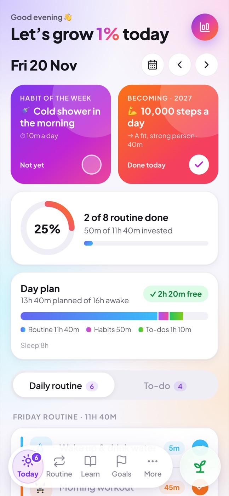
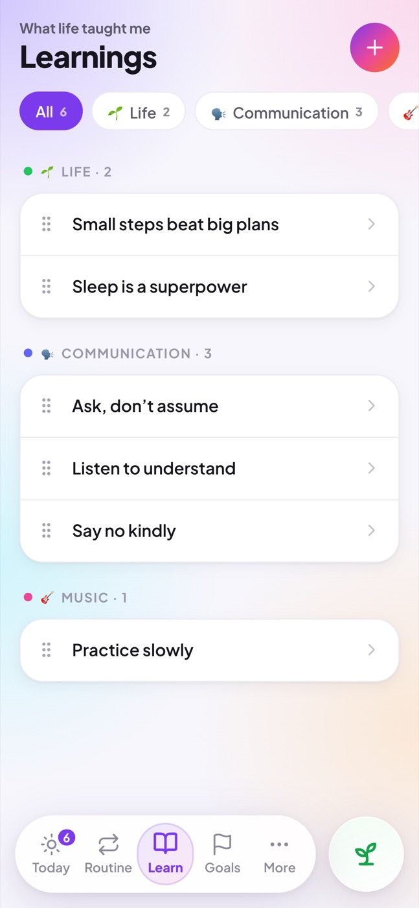
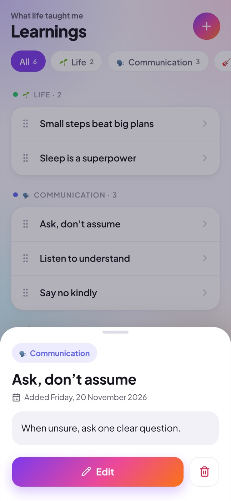
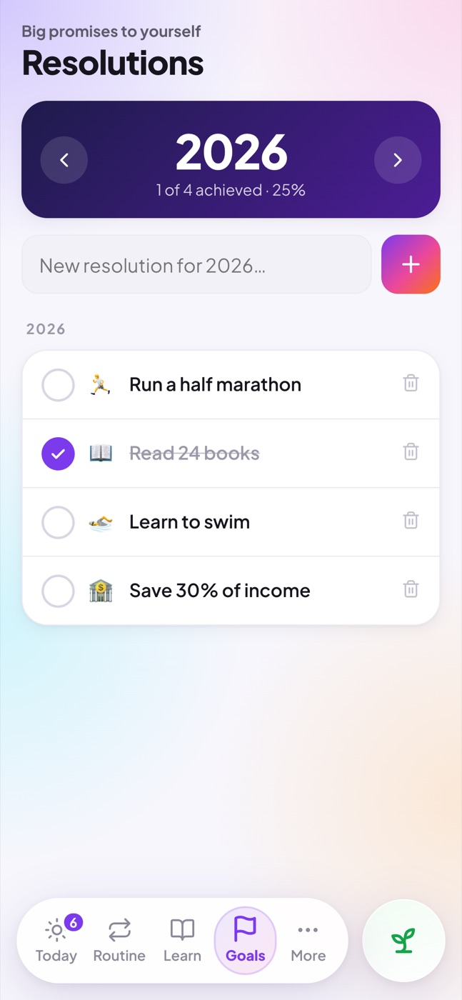
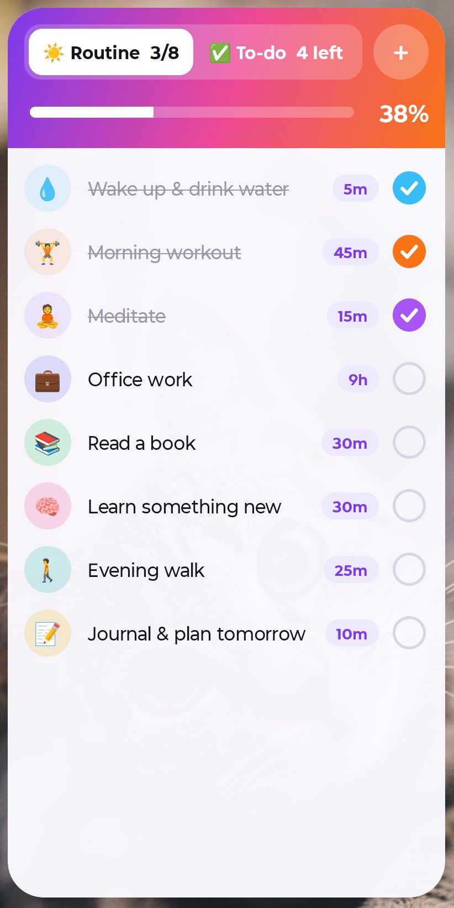
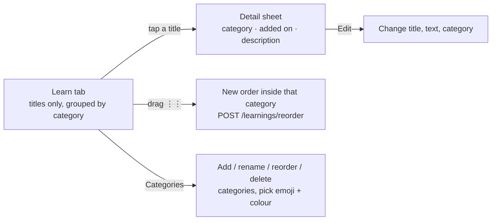
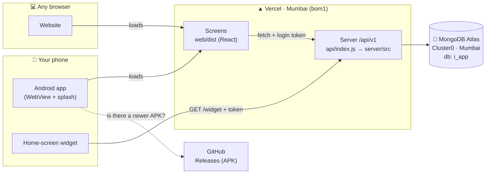
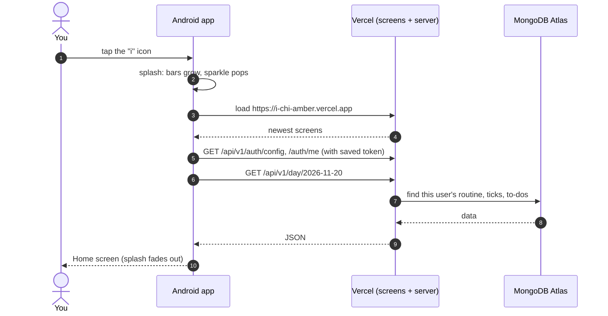
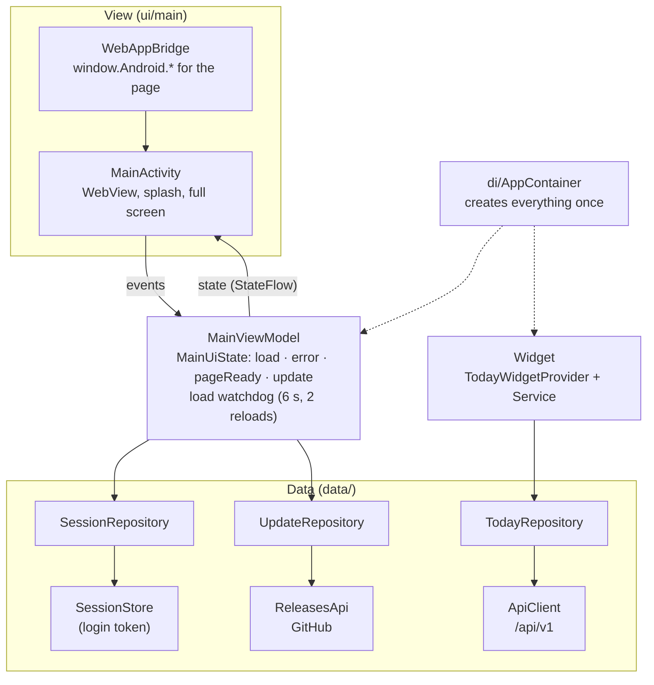
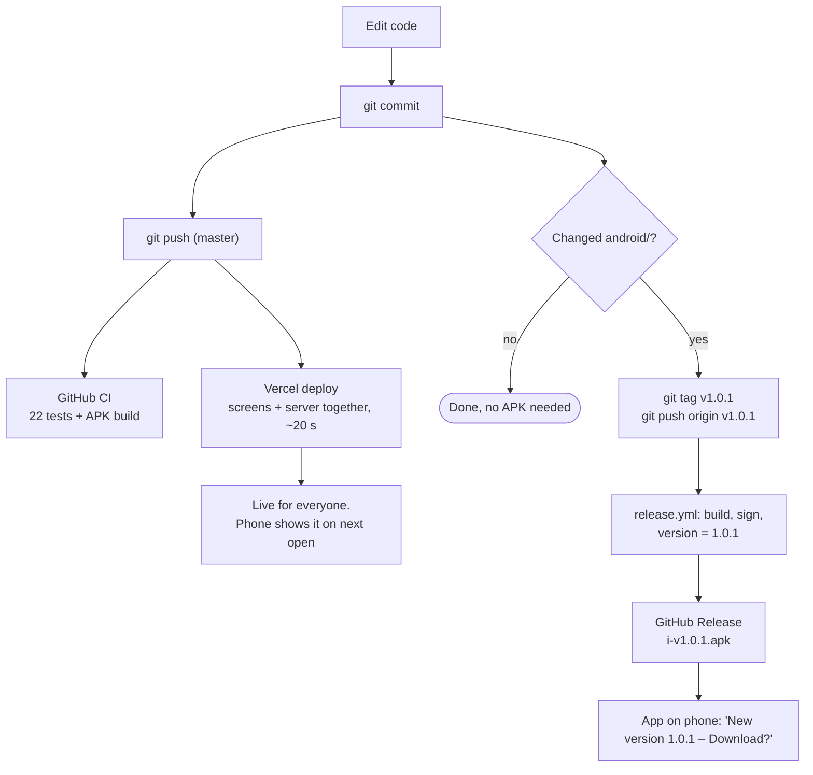

<div align="center">


# i

**Grow 1% every day.** Your daily routine, to-dos, habits and goals in one colourful app, with a home-screen widget.

[**Open the live app →**](https://i-chi-amber.vercel.app) &nbsp;·&nbsp; Android: see [Releases](https://github.com/itssinghankit/i/releases) &nbsp;·&nbsp; by **itssinghankit**


</div>

---

## Screens

| Today | To-do | Routine (per weekday) | Week chart |
|:---:|:---:|:---:|:---:|
|  |  |  |  |
| Habit cards, progress ring, **Day plan** (does it all fit in a day?) | Office tasks sit **inside** Office work; others add their own time | Each weekday has its own routine and total hours | % of routine done per day, ‹ › to change week |

| Learnings | A learning | Goals | Home-screen widget |
|:---:|:---:|:---:|:---:|
|  |  |  |  |
| Titles only, grouped by **your own categories**; drag ⋮⋮ to reorder | Tap a title: category, day it was added, the full note | Resolutions per year | Routine / To-do tabs, today's %, rows in each item's colour; tap a row to tick it |

## What it does

| Feature | Where |
|---|---|
| Daily routine with time per item, tick to mark done | Today → Daily routine |
| Different routine per weekday (e.g. weekends) | Routine tab → Mon…Sun |
| **Day plan**: routine + habits + to-dos vs. waking hours | Today |
| To-dos, optionally **inside** a fixed-time item like Office work | Today → To-do → + |
| Habit of the week, "graduates" into the routine after 5/7 days | 🌱 button |
| **Learnings**: what life taught you, in categories (Life, Communication, Music 🎸…) | Learn tab |
| Who I want to be + its daily habit (shown on Home) | More → Who I want to be |
| Resolutions per year, Needs vs Wants (with ₹ totals) | Goals tab, More |
| Week chart and colour-coded calendar | 📊 button, 📅 button |
| **Insights**: the app reads your last 14 days and suggests changes | More → Insights |
| Resizable home-screen widget: today's %, coloured routine rows, tick from the home screen | Android home screen |
| Emoji and music icons (🎵 🎸 🎹 🥁 🎧 …) for routine items and categories | Any emoji picker |

### Learnings



- A learning has a **title**, a **description**, a **category** and the **day it was added** (set by the server).
- Order is kept **per category**: dragging can't move a learning into another category by mistake.
- Deleting a category asks first, then deletes its learnings too.

## How it fits together



- **The phone app is a thin shell:** it shows the website inside the app (a WebView), plus native parts: splash screen, widget and update check.
- **Most changes need no new APK:** push to GitHub, Vercel redeploys, and the phone shows the new screens on its next open.

### What happens when you open the app



**Each person's data is kept apart automatically.** `server/src/db/scoped.js` adds the signed-in `userId` to every read and write, so feature code can't see another user's data by mistake. The tests check this.

---

## Folder map

```
i/
├── web/src/                    React screens (Vite)
│   ├── app/                    App shell (tabs, keep-alive screens), AuthGate
│   ├── features/<feature>/     one folder per feature: today, routine, learnings, goals, habits, todos, account
│   │   └── learnings/          api.js (calls) → useLearnings.js (state) → LearningsScreen / LearningSheet / …
│   ├── components/             shared UI: Sheet, Check, Ring, ReorderRow, EmojiPicker, palette (colours, emoji, music icons)
│   └── lib/                    api client + login token, dates, formatting, haptics
├── server/                     Node + Express
│   ├── src/app.js              list of features → add one line per new feature
│   ├── src/modules/            one file per feature (days, lists, learnings, insights, auth, widget…)
│   ├── src/db/                 storage (MongoDB or local file) + per-user scoping
│   └── test/                   22 API tests (incl. two users kept apart)
├── api/index.js                Vercel entry: runs the same Express app
├── vercel.json                 Vercel build + routing
├── android/                    Android app (MVVM, see below)
└── .github/workflows/          ci.yml (tests on every push), release.yml (APK on tags)
```

### Android app: MVVM



```
android/app/src/main/java/com/itssinghankit/i/
├── IApplication.kt             creates the AppContainer
├── di/AppContainer.kt          manual dependency injection
├── data/
│   ├── model/                  TodaySnapshot, TodayItem, UpdateInfo
│   ├── local/SessionStore.kt   login token for the widget
│   ├── remote/                 ApiClient (server), ReleasesApi (GitHub)
│   └── repository/             SessionRepository, TodayRepository, UpdateRepository
├── ui/main/                    MainActivity (View), MainViewModel, WebAppBridge, LoadErrorPage
├── auth/                       native account sheet (Credential Manager)
└── widget/                     home-screen widget (uses TodayRepository)
```

---

## Run it on your Mac

No database needed: it runs on a local file with dummy data.

```bash
cd i/web && npm install && npm run build
```

```bash
cd i/server && npm install && npm start
```

Open http://localhost:4600. For live-reload while editing screens, run `npm run dev` in `web/` (http://localhost:5180).

```bash
cd i && npm test
```

### Dev vs. prod: where each build gets its data

| What | Dev | Prod |
|---|---|---|
| Website | `npm start` → http://localhost:4600 | https://i-chi-amber.vercel.app |
| Android app + widget | **debug** build → `I_DEV_URL` = `http://localhost:4600` (your Mac, through `adb reverse` over USB) | **release** build → `I_APP_URL` = `https://i-chi-amber.vercel.app` |
| Set in | `android/gradle.properties` | `android/gradle.properties` |
| Database | local file `server/data/db.json` | MongoDB Atlas (`MONGODB_URI` on Vercel) |

The Android code reads one value, `BuildConfig.APP_URL`. `android/app/build.gradle.kts` fills it per build type:

```kotlin
buildTypes {
    debug   { buildConfigField("String", "APP_URL", "\"${prop("I_DEV_URL")}\"") }   // your Mac
    release { buildConfigField("String", "APP_URL", "\"${prop("I_APP_URL")}\"") }   // Vercel
}
```

`AppContainer` hands `BuildConfig.APP_URL` to the WebView and to the widget's `ApiClient`. Every debug build runs `adb reverse tcp:4600 tcp:4600` first, so `localhost` on a USB phone reaches your Mac.

---

## Releasing



### Web + server (most changes)

```bash
cd i && git add -A && git commit -m "What changed" && git push
```

### Android (widget, splash, icon, permissions, server address)

```bash
cd i && git push && git tag v1.0.1 && git push origin v1.0.1
```

| Part | What it does |
|---|---|
| `cd i` | go to the project folder |
| `&&` | run the next part only if this one worked |
| `git push` | send your latest commits to GitHub (Vercel deploys them) |
| `git tag v1.0.1` | put a version label on your latest commit |
| `git push origin v1.0.1` | send the label to GitHub; this starts `release.yml` |

**No manual version editing.** Unlike a typical Play Store setup, you don't edit `versionCode`/`versionName` by hand. `android/app/build.gradle.kts` reads them from the tag:

| Tag | `versionName` | `versionCode` |
|---|---|---|
| `v1.0.0` | 1.0.0 | 10000 |
| `v1.0.1` | 1.0.1 | 10001 |
| `v1.2.0` | 1.2.0 | 10200 |
| `v2.0.0` | 2.0.0 | 20000 |

Rules: always go **up**, and use `vMAJOR.MINOR.PATCH` with each part below 100. Every APK is signed with the same key (`~/i-release.jks`, in GitHub secrets), so it installs over the old one. **Back up that key file and its password; without them the app can never be updated again.**

---

## Settings

### Vercel → Settings → Environment Variables

| Name | Needed | What |
|---|---|---|
| `MONGODB_URI` | ✅ | Atlas connection link (with password; `@` in the password written as `%40`) |
| `SESSION_SECRET` | ✅ | Long random text that signs login tokens (32+ characters) |
| `APP_TZ` | no | Time zone for "today" (default `Asia/Kolkata`) |
| `SEED_DEMO` / `ALLOW_RESET` | no | Dummy data / reset button (off on real databases) |

### `android/gradle.properties`

| Name | What |
|---|---|
| `I_APP_URL` | Release builds load this (Vercel) |
| `I_DEV_URL` | Debug builds load this (your Mac) |
| `I_GITHUB_REPO` | Where the app checks for new APKs |

### GitHub → Settings → Secrets → Actions
`I_KEYSTORE_BASE64`, `I_KEYSTORE_PASSWORD`, `I_KEY_ALIAS`, `I_KEY_PASSWORD`: the signing key, used only by `release.yml`.

---

## Adding a feature

1. **Server:** a new file in `server/src/modules/` (a `crudRouter(store, 'books', { fields: [...] })` covers list/add/edit/delete), one line in `MODULES` in `server/src/app.js`, and `'books'` in `COLLECTIONS` in `server/src/db/store.js` (so it's private per user). Add a test in `server/test/`.
2. **Screen:** a folder `web/src/features/books/` with `api.js` (calls), a `useBooks.js` hook (state) and the screen; then a tab in `TABS` or an entry in the More menu in `web/src/app/App.jsx`. Copy `features/learnings/` as the template.
3. **New insight:** one function in `RULES` in `server/src/modules/insights.js`.
4. **Breaking API change:** add `/api/v2` next to `/api/v1`, so older APKs keep working.

## Troubleshooting

| You see | Why | Fix |
|---|---|---|
| `{"error":"database not reachable"}` | Wrong `MONGODB_URI` or Atlas network access | Check the link (one `@`), Atlas → Network Access has `0.0.0.0/0` |
| Widget: "Sign in to see your day" | No login saved on the phone | Open the app and sign in once |
| APK won't install over the old one | Signed with a different key | Always build through `release.yml` with the same key |
